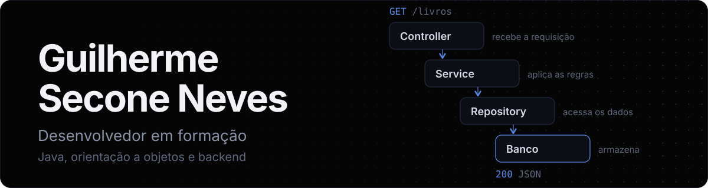

## Sobre
 
Estudo Análise e Desenvolvimento de Sistemas na FATEC de São José do Rio Preto e escolhi o backend porque quero entender o que acontece entre o clique de quem usa o sistema e o dado salvo: a requisição chega, as regras são aplicadas, o banco responde. Java e orientação a objetos são a base dessa formação.
 
Aprendo construindo projetos reais. Uso IA como apoio, mas só considero algo meu quando consigo explicar como funciona. O próximo passo é um projeto backend completo em Java, com Spring Boot, SQL e uma API REST.
 
## Projetos
 
**Verbum**  
Site de leitura da Bíblia Católica feito em React. Reúne a leitura dos textos, favoritos, coleções e uma área dedicada ao conteúdo católico.  
`React`
 
**Gesture Studio**  
Controle de interface por gestos, capturados pela webcam. Um projeto de visão computacional para navegar na tela sem encostar no mouse.
 
**Controle Financeiro** — [código](https://github.com/secony/cash-cadence-corner)  
Painel de finanças pessoais para registrar receitas, despesas e metas de economia. Começou no Firebase e foi migrado para o Supabase.  
`Supabase`
 
**Estudos de Java** — [código](https://github.com/secony/estudos-java)  
Exercícios e pequenos projetos de Java e orientação a objetos, o laboratório onde pratico a base antes de levá-la para APIs.  
`Java`
 
## Tecnologias
 

## Contato
 
Portfólio: [guilhermeseconeneves.vercel.app](https://guilhermeseconeneves.vercel.app)  
LinkedIn: [linkedin.com/in/secone-undefined-68923837a](https://www.linkedin.com/in/secone-undefined-68923837a)
 
